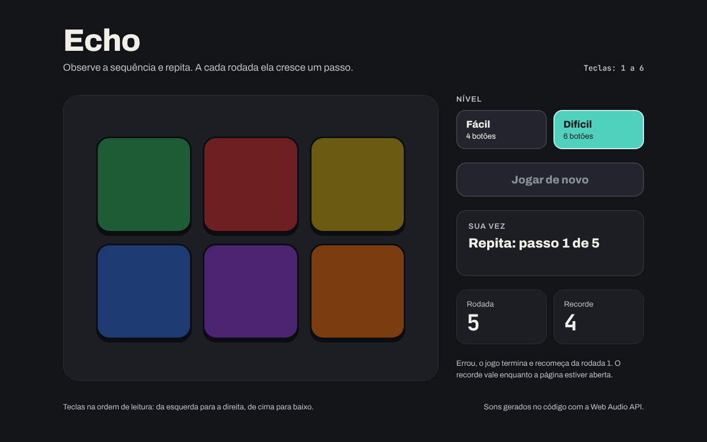

# Echo

Jogo da memória de sequências no estilo Genius, feito com HTML, CSS e JavaScript puro.

**Deploy:** https://echo-renanferreira-dev.vercel.app

## Como rodar

Baixe ou clone o repositório e abra o `index.html` no navegador. Não precisa instalar nada.

## Etapas

Projeto de aula: cada etapa é um commit na `main`. Use `git log --oneline` para ver a lista e `git checkout <hash>` para abrir o projeto como ele estava naquela etapa (`git switch main` volta para a versão final).

| Etapa | Conceito |
|---|---|
| `00-ponto-de-partida` | Projeto vazio: README, .gitignore, LICENSE e index.html |
| `01-tabuleiro-em-html-e-css` | A página do design, sem JavaScript |
| `02-acendendo-um-botao` | Função com parâmetro que acende o botão clicado |
| `03-som-com-web-audio` | `AudioContext` e `OscillatorNode` geram o som de cada botão |
| `04-sorteando-a-sequencia` | Array, `Math.random()` e `push` |
| `05-mostrando-a-sequencia` | Timers escalonados com `forEach` e `setTimeout` |
| `06-mensagens-na-tela` | `textContent` e `aria-live` |
| `07-vez-do-jogador` | Estado do jogo: comparar o clique com a sequência |
| `08-travando-os-botoes` | `disabled` durante a demonstração |
| `09-fim-de-jogo` | Errou: fim de jogo e "Jogar de novo" |
| `10-rodada-e-recorde` | Placar com `sequence.length` e `Math.max` |
| `11-jogando-pelo-teclado` | `keydown` chamando `button.click()` |
| `12-niveis` | Fácil (4 botões) e Difícil (6 botões) |

## Pontos de atenção

### Onde costuma travar

- `02-acendendo-um-botao`: a função recebe o botão como parâmetro. Escrever uma função por cor (`lightGreen`, `lightRed`...) funciona, mas repete o mesmo código quatro vezes.
- `03-som-com-web-audio`: o `AudioContext` precisa nascer dentro de um clique. Criado ao carregar a página, ele fica `suspended` e não toca nada, sem erro na tela.
- `03-som-com-web-audio`: um oscilador só toca uma vez; chamar `start()` de novo dá erro. Por isso cada toque cria um oscilador novo.
- `03-som-com-web-audio`: parar o oscilador no meio da onda faz um estalo. O volume desce até 0 antes do `stop()`.
- `04-sorteando-a-sequencia`: `Math.random() * 4` nunca chega a 4, e o `Math.floor` dá 0, 1, 2 ou 3. Com `Math.round`, o 0 e o 3 sairiam com metade da chance dos outros.
- `05-mostrando-a-sequencia`: todos os `setTimeout` são criados no mesmo instante. Com o mesmo atraso para todos, os botões acendem juntos; quem espaça é o `(index + 1) * 700`.
- `05-mostrando-a-sequencia`: dá para clicar nos botões enquanto a sequência toca. É de propósito: a `08` resolve com `disabled`.
- `07-vez-do-jogador`: o clique é comparado com `sequence[step]`, o passo atual, e não com o último botão sorteado.
- `09-fim-de-jogo`: a rodada em que o jogador errou não conta. Por isso `sequence.length - 1`.
- `10-rodada-e-recorde`: recarregar a página zera o recorde. A variável vive só enquanto a página está aberta.
- `11-jogando-pelo-teclado`: o `event.key` vem como texto (`"1"`), então a comparação usa `String(index + 1)`.
- `11-jogando-pelo-teclado`: segurar a tecla repete o `keydown`. Sem o `event.repeat`, um aperto longo vale vários cliques.
- `12-niveis`: `click()` num botão `disabled` não faz nada, mas num botão `hidden` funciona. O teclado precisa conferir o nível com `index < buttonCount`.

### O que eu faria diferente

- O momento do jogo (observando, sua vez, fim) está espalhado entre `step`, `sequence` e o `disabled` dos botões. Uma variável só para a fase do jogo deixaria isso mais claro.
- Depois da primeira partida, o botão principal continua escrito "Jogar de novo" (apagado) durante as rodadas seguintes. Voltar o texto para "Começar" no início da partida resolveria.
- Faria o push e o deploy na Vercel logo na `01`, e não no fim, como diz a regra dos projetos.
- O recorde poderia sobreviver ao recarregar com `localStorage`, que fica para outro projeto.
- A página foi pensada para telas de 1280 px. Uma versão para celular seria o próximo passo.

## Créditos

- Sons gerados no código com a Web Audio API, sem arquivos de áudio.
- Fontes [Archivo](https://fonts.google.com/specimen/Archivo) e [JetBrains Mono](https://fonts.google.com/specimen/JetBrains+Mono), do Google Fonts, sob a licença SIL Open Font License.
- Inspirado no jogo Genius (Simon), da década de 1970.
